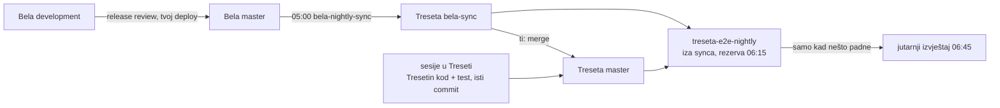

# Orkestracija agenata — Treseta

Cilj: isti način rada kao u Beli, ali samo onoliko koliko Treseti treba. Kod je uglavnom Belin i stiže noćnim
syncom ([`BELA_SYNC.md`](BELA_SYNC.md)), pa Treseta nema svoj fixer ni release review: svaku noć testira ono što
ima i ono što je sync donio, a ujutro se javi **samo kad nešto ne radi**. Testove piše onaj tko piše kod, u istom
commitu, kao u Beli. Belin krovni plan je `../Bela-Treseta-Tournamnet-app/ORKESTRACIJA_AGENATA.md`.

## Kako ide

## 0. Dokumenti

| File | Čemu služi | Stanje |
| --- | --- | --- |
| `ORKESTRACIJA_AGENATA.md` | ovaj plan: tim, kako se testira, što javlja jutarnji izvještaj, faze | 15.11. |
| [`UNIT_PLAN.md`](UNIT_PLAN.md) | unit i db testovi: stanje, rupe u Tresetinom kodu, backlog | 15.11. |
| [`E2E_PLAN.md`](E2E_PLAN.md) | Playwright: što dolazi iz Bele, a što Treseta mora imati svoje | 15.11. |
| skill `testovi` (`.claude/skills/testovi/SKILL.md`) | pravila **za agente**: koji test uz koju promjenu i kako se piše; Belin, s Tresetinim pravilima igre | 15.11. |
| agent `e2e-reviewer` (`.claude/agents/`) | provjeri testove u diffu prema skillu; Belin, plus provjera da Tresetin kod ima test ovdje, a zajednički ide u Belu | 15.11. |
| `.githooks/pre-commit` | `npm test` prije commita koji dira kod (~6 s); isti kao Belin | 15.11. |
| `scripts/test-db-local.sh` | `npm run test:db:local`: db testovi na svježoj bazi u `bela-e2e-pg`; isti kao Belin, ista baza | 15.11. |
| [`rutine/`](rutine/README.md) | `README.md` (tim, pravila, brava, izvještaj) i prompt rutine `treseta-e2e-nightly` | 15.11. |
| [`docs/arhiva/`](docs/arhiva/README.md) | stari planovi (prijelaz, konferencije, turniri, zvanja), `ProcessFlow.md`, `Task.md` | 15.11. |
| [`BELA_SYNC.md`](BELA_SYNC.md) | po čemu se Treseta razlikuje od Bele i kako sync to čuva | postoji |

Planovi su za odluke i čitaš ih ti. Skill `testovi`, `CLAUDE.md` i `rutine/` su za agente.

## 1. Tim

| Rutina | Gdje živi prompt | Kad (Zagreb) | Što radi |
| --- | --- | --- | --- |
| `bela-nightly-sync` | Bela, `rutine/bela-nightly-sync.md` | 05:00 | deployani Belini commitovi → `bela-sync`, provjere i klik na lokalnoj bazi; na kraju pokrene noćni test |
| `treseta-e2e-nightly` | ovdje, `rutine/treseta-e2e-nightly.md` | iza synca; rezerva 06:15 | unit, db, lint i tsc (i Playwright kad ga bude) na `master`u i na `bela-sync`u; izvještaj, bez issuea |
| `bela-jutarnji-izvjestaj` | Bela, `rutine/bela-jutarnji-izvjestaj.md` | 06:45 | jedna poruka; red za Tresetu samo kad nešto ne radi ili `bela-sync` čeka merge |
| sesije u Treseti | — | po danu | Tresetin vlastiti kod, s testom u istom commitu |

**Nema** fixera, release reviewa, scana ni UX patrole za Tresetu (odlučeno 15.11.). Kod je skoro isti kao u Beli,
pa ga te Beline rutine već pokrivaju, a popravak zajedničkog koda ionako ide u Belu.

## 2. Testovi u Treseti

- **Zajednički kod:** test piše sesija u Beli, uz promjenu, i dolazi syncom zajedno s kodom.
- **Tresetin kod** (Differences u `BELA_SYNC.md`: pravila igre, konferencije, lokacije, Tresetine razlike u
  turnirima): test se piše ovdje, u istom commitu, a test file se upiše u `BELA_SYNC.md` uz kod.
- **Belin test koji ne vrijedi za Tresetu** (1001, Belina zvanja, bela, tko je zvao): sync ga prilagodi ili ne
  prenese, isto kao kod (`BELA_SYNC.md`, Game rules).
- **Pravilo** je u `CLAUDE.md` (3 retka) i u skillu `testovi`. Hook pokrene `npm test` prije commita, a
  `e2e-reviewer` provjeri testove u diffu.
- **Ispravak buga** ima test koji je bez popravka crven. Ako je bug u zajedničkom kodu, ispravak i test idu u Belu.

## 3. Što javlja jutarnji izvještaj

Jedan red "Treseta" pod *Čeka tebe*, samo kad:
- noćni test na `master`u ili `bela-sync`u nije zelen, s tim gdje pripada: *došlo syncom* (ne mergeaj
  `bela-sync` dok se ne popravi), *zajedničko* (popravak u Beli) ili *Tresetino* (popravak ovdje);
- se rutina nije javila ili je stala (⏸);
- `bela-sync` čeka tvoj merge (to već postoji).

Zelena noć ne piše ništa o Treseti.

## 4. Faze

| Faza | Što | Gotovo kad |
| --- | --- | --- |
| **T1 Temelj** | skill `testovi`, agent `e2e-reviewer`, pravilo u `CLAUDE.md`, `pre-commit` hook, `test:db:local`, `rutine/`, planovi, `docs/arhiva/` (15.11.) | sesija bez upute napiše test uz promjenu Tresetinog koda |
| **T2 Noćni test** | scheduled task `treseta-e2e-nightly`; u Beli: sync ga pokrene na kraju, jutarnji izvještaj ga čita | jedna noć s izvještajem, jedno jutro s crvenim redom kad je nešto palo |
| **T3 Rupe** | backlog iz `UNIT_PLAN.md` (P1 prvi) | P1 zelen |
| **T4 E2E** | kad Bela složi Playwright suite: Tresetin generator i testovi upisa igre (`E2E_PLAN.md`) | noćni run vrti Playwright |

## 5. Odluke (15.11.)

- Treseta ima samo noćni test; fixer, release review, scan i UX patrola ostaju Belini.
- Noćni test ne otvara issuee. Javlja se kroz jutarnji izvještaj, i to samo kad nešto ne radi.
- Prompt Tresetine rutine je u `rutine/` na `master`u. Sync i jutarnji izvještaj ostaju u Belinom `rutine/`, a
  Tresetina rutina piše izvještaj u Belin `reports/rutine/`, jer ga jutarnji izvještaj tamo čita.
- Belin test-tok (skill, agent, hook, skripta, planovi) prenesen je ručno 15.11., prije synca, jer ga Bela još
  nije deployala. `BELA_SYNC.md` kaže kako sync postupa s tim commitovima kad do njih dođe.
- Otvoreno: Tresetin generator podataka (`E2E_PLAN.md`, pogl. 5).
